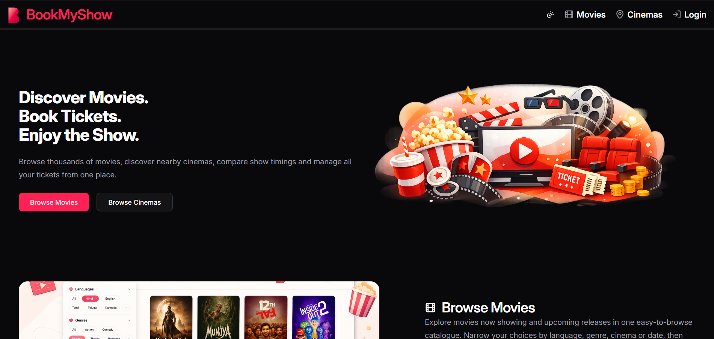
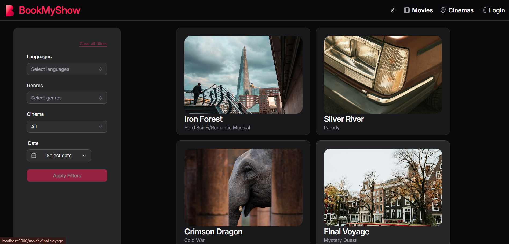
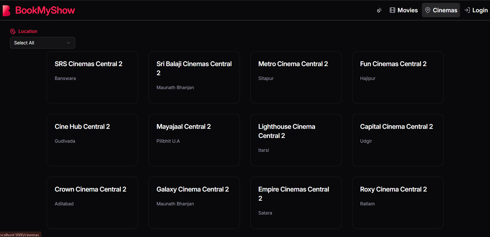
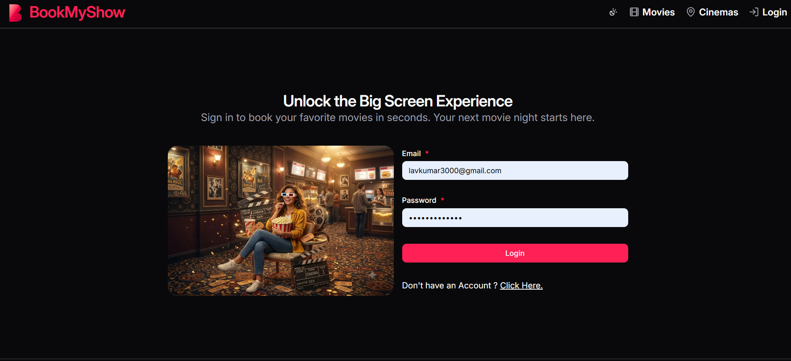
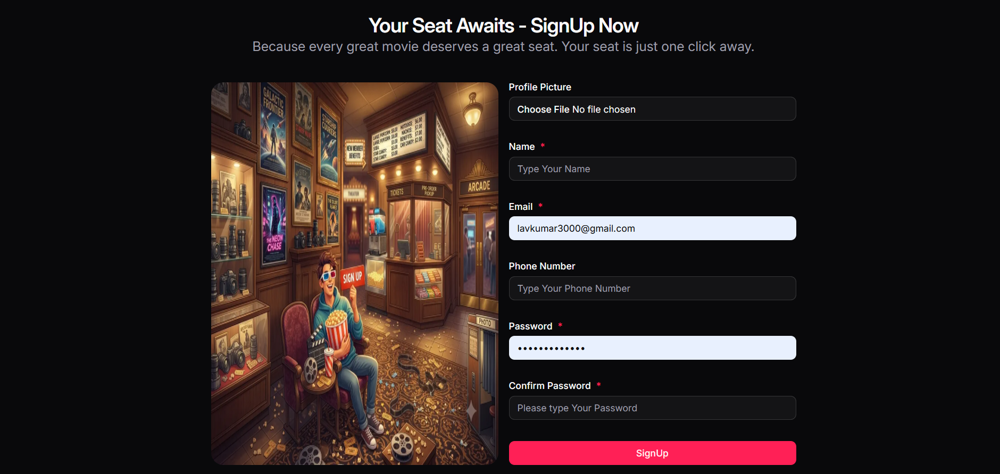
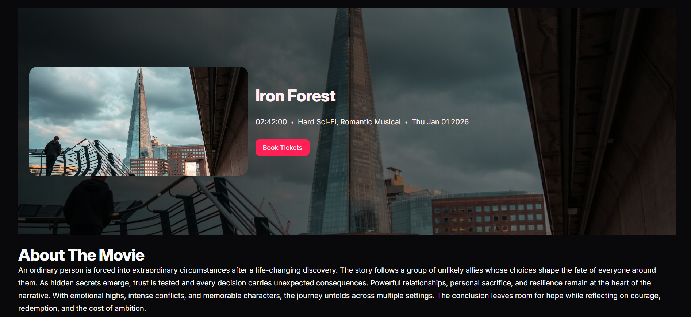
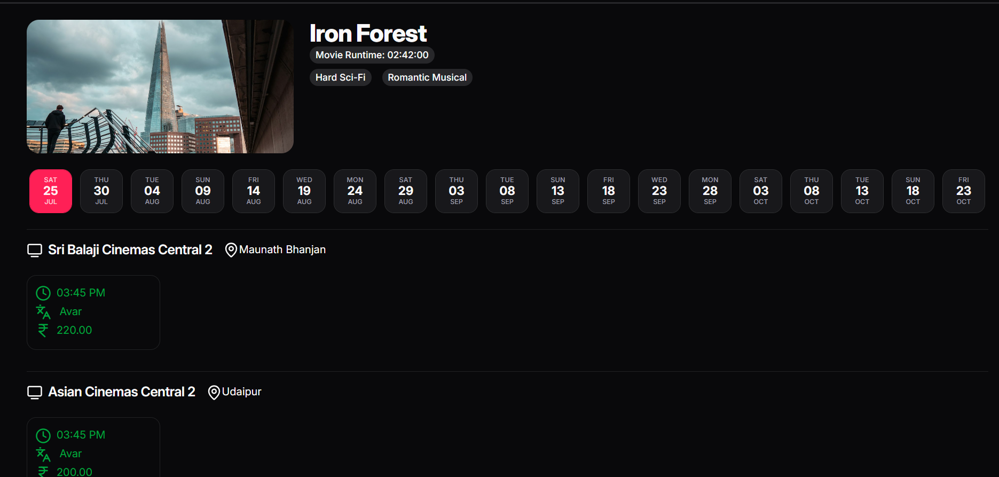
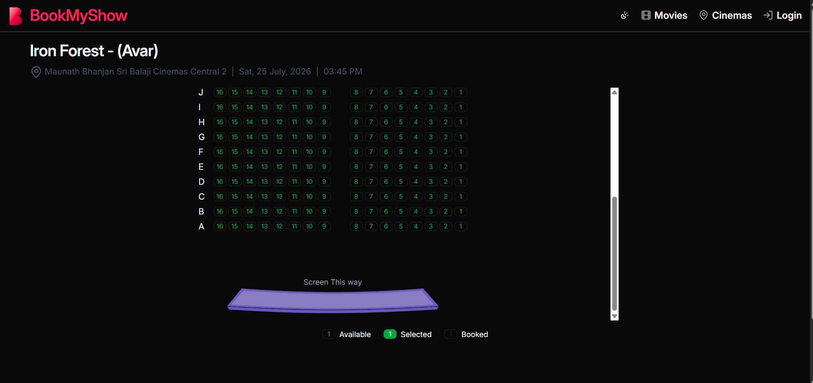

# BookMyShow Frontend

[Visit The Backend Code](https://github.com/lav5588/BookMyShow-backend)

A responsive movie discovery and ticket-booking frontend built with React, TypeScript, and Vite. It lets users browse movies and cinemas, filter show listings, manage bookings, and access account-related screens.

---

## Documentation

Explore our comprehensive documentation suite in the [`docs/`](docs/) directory:

| Document                                                   | Description                                                              |
| :--------------------------------------------------------- | :----------------------------------------------------------------------- |
| [**Documentation Index**](docs/INDEX.md)                   | Central hub and navigation portal for all project documentation.         |
| [**Architecture Overview**](docs/ARCHITECTURE.md)          | System design, component layering, data flow, and build pipeline.        |
| [**Setup & Installation**](docs/SETUP-AND-INSTALLATION.md) | Step-by-step setup guide for Windows, macOS, and Linux.                  |
| [**Development Guide**](docs/DEVELOPMENT-GUIDE.md)         | Daily developer workflows, container patterns, and pre-PR checklist.     |
| [**Project Structure**](docs/PROJECT-STRUCTURE.md)         | Complete directory tree and file naming conventions.                     |
| [**Requirements Specification**](docs/REQUIREMENTS.md)     | Detailed functional and non-functional specifications.                   |
| [**Routing Architecture**](docs/ROUTING.md)                | React Router 7 setup, layout hierarchy, and route parameters.            |
| [**State Management**](docs/STATE-MANAGEMENT.md)           | Redux Toolkit store, `authSlice`, and RTK Query caching policies.        |
| [**API Integration Reference**](docs/API-INTEGRATION.md)   | Complete catalog of RTK Query endpoints, types, and polling intervals.   |
| [**Authentication & Sessions**](docs/AUTHENTICATION.md)    | JWT auth lifecycle, token refresh, and user profile management.          |
| [**Environment Variables**](docs/ENVIRONMENT-VARIABLES.md) | Configuration guide for `PORT`, `VITE_BASE_URL`, and security practices. |
| [**Error Handling Strategy**](docs/ERROR-HANDLING.md)      | Route error boundaries, 404 fallbacks, and user error notifications.     |
| [**Accessibility (a11y) Guide**](docs/ACCESSIBILITY.md)    | WCAG 2.1 AA standards, Radix primitives, and keyboard navigation.        |
| [**Coding Standards**](docs/CODING-STANDARDS.md)           | TypeScript guidelines, ESLint flat config, and Prettier rules.           |
| [**Authors & Maintainers**](docs/AUTHORS.md)               | Creator, lead maintainer, and architectural ownership details.           |
| [**Contributors Guide**](docs/CONTRIBUTORS.md)             | Contribution lifecycle, community guidelines, and hall of fame.          |
| [**Code Owners**](docs/CODE_OWNERS.md)                     | GitHub CODEOWNERS definitions and domain ownership mappings.             |

---

## Features

- Browse current, latest, and upcoming movies
- Filter movies by language, genre, cinema, and date
- Explore cinemas and their available movie slots
- View movie, cinema, and booking details
- Authentication flows for sign up, login, token refresh, and logout
- Profile and ticket management screens
- Responsive landing, About Us, and Contact Us pages
- Dark and light theme support
- Not Found and route error fallback screens

## Tech stack

- React 19 and TypeScript
- Vite 7
- React Router 7
- Redux Toolkit and RTK Query
- Tailwind CSS 4 and shadcn/ui components
- React Hook Form and Zod
- Lucide icons and Sonner notifications

## Prerequisites

- Node.js `v22.19.0` (see [`.nvmrc`](.nvmrc))
- npm
- A running BookMyShow backend API (see [SETUP-AND-INSTALLATION.md](docs/SETUP-AND-INSTALLATION.md))

## Getting started

1. Clone the repository and open the frontend directory.

2. Use the expected Node.js version:

    ```bash
    nvm use
    ```

3. Install dependencies:

    ```bash
    npm ci
    ```

4. Create your local environment file from the example:

    ```bash
    cp .env.example .env
    ```

    On Windows PowerShell:

    ```powershell
    Copy-Item .env.example .env
    ```

5. Set the backend API URL in `.env`:

    ```env
    PORT=3000
    VITE_BASE_URL=http://localhost:8000/api
    ```

6. Start the development server:

    ```bash
    npm run dev
    ```

    The app runs on `http://localhost:3000` when `PORT=3000` is configured.

## Available scripts

| Command                | Description                                         |
| ---------------------- | --------------------------------------------------- |
| `npm run dev`          | Starts the Vite development server.                 |
| `npm run build`        | Type-checks the app and creates a production build. |
| `npm run preview`      | Serves the production build locally.                |
| `npm run lint`         | Runs ESLint across the project.                     |
| `npm run lint:fix`     | Runs ESLint and applies safe fixes.                 |
| `npm run ts:check`     | Runs TypeScript without emitting files.             |
| `npm run prettier`     | Checks formatting with Prettier.                    |
| `npm run prettier:fix` | Formats files with Prettier.                        |
| `npm run prepare`      | Installs Husky Git hooks.                           |

## Routes

For detailed route documentation and parameters, see [docs/ROUTING.md](docs/ROUTING.md).

| Route                | Purpose                                             |
| -------------------- | --------------------------------------------------- |
| `/`                  | Home page with movie and cinema discovery sections. |
| `/movies`            | Movie catalogue and filters.                        |
| `/movie/:slug`       | Movie details.                                      |
| `/movie/:slug/slots` | Movie showtimes.                                    |
| `/cinemas`           | Cinema catalogue.                                   |
| `/cinema/:id`        | Cinema details and slots.                           |
| `/booking/:slotId`   | Seat selection and booking flow.                    |
| `/login`             | Login page.                                         |
| `/signup`            | Registration page.                                  |
| `/profile`           | User profile and ticket details.                    |
| `/about`             | About Us page.                                      |
| `/contact`           | Contact Us page.                                    |
| `*`                  | Not Found fallback for unmatched routes.            |

## Project structure

For an in-depth breakdown of directories, files, and architectural roles, see [docs/PROJECT-STRUCTURE.md](docs/PROJECT-STRUCTURE.md).

```text
src/
├── assets/         # Images, fonts, and SVG illustrations
├── components/     # Shared UI and feature components
├── constants/      # API, format, and route constants
├── containers/     # Page-level feature logic and configuration
├── features/       # Redux slices
├── layouts/        # Shared application layouts
├── pages/          # Route-level page components
├── router/         # React Router configuration
├── services/       # RTK Query API services and API types
├── store/          # Redux store and typed hooks
└── index.tsx       # Application entry point
```

## Environment variables

For detailed security guidelines and configuration examples, see [docs/ENVIRONMENT-VARIABLES.md](docs/ENVIRONMENT-VARIABLES.md).

| Variable        | Required | Description                                |
| --------------- | -------- | ------------------------------------------ |
| `VITE_BASE_URL` | Yes      | Base URL for the backend API.              |
| `PORT`          | No       | Local development and preview server port. |

Only variables prefixed with `VITE_` are exposed to the frontend by Vite. Do not place secrets in frontend environment files.

## Quality checks

Run these before opening a pull request:

```bash
npm run prettier
npm run lint
npm run ts:check
npm run build
```

## Production build

Create an optimized production bundle with:

```bash
npm run build
```

The generated files are placed in `dist/`. Production builds minify JavaScript, remove `console` calls, hide source maps, and optimize supported raster image assets.

## Previews Of the Application









