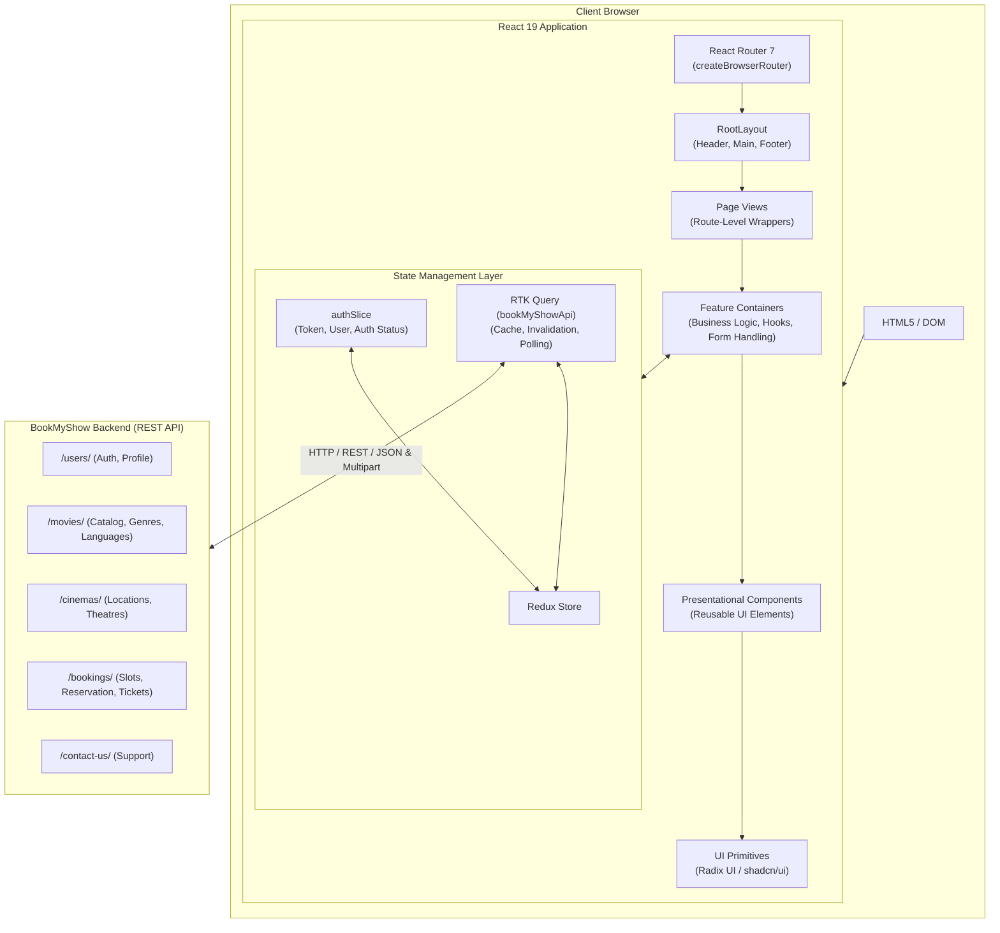
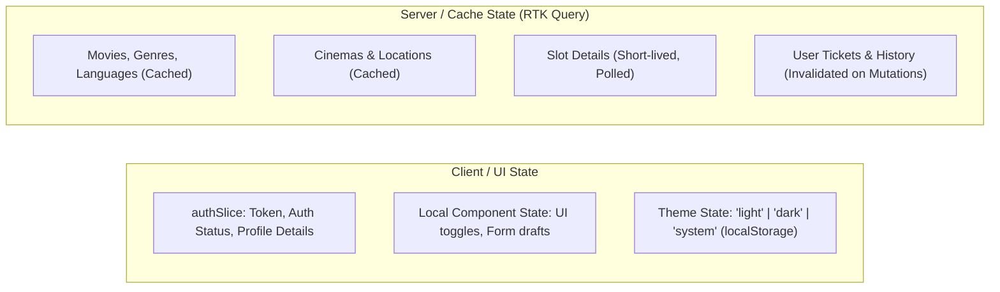

# System Architecture

This document provides a comprehensive overview of the software architecture and structural design of the **BookMyShow Frontend** web application.

---

## Architectural Goals

The BookMyShow frontend is designed to satisfy the following core principles:

1. **High Performance & Fast Interactivity**: Sub-second initial render times using Vite 7, optimized bundle splitting, asset compression, and efficient re-rendering in React 19.
2. **Predictable Data Flow**: Clear separation of server state (caching, pagination, real-time polling) managed by **RTK Query** and local UI state managed by **Redux Toolkit slices** and React hooks.
3. **Strict Type Safety**: End-to-end TypeScript enforcement covering API responses, component props, form schemas, and routing parameters.
4. **Separation of Concerns**: A strict **Page-Container-Component** hierarchy ensuring business logic and presentation remain decoupled and testable.
5. **Modern Design System**: Component-driven architecture using **Tailwind CSS 4**, **Radix UI**, and **shadcn/ui** primitives supporting fluid light/dark theming.

---

## High-Level Architecture

The frontend acts as a single-page application (SPA) communicating with the Django REST backend over HTTP/REST APIs.

---

## Key Architectural Layers

### 1. Presentation & Component Hierarchy

The UI layer is structured into four distinct levels to guarantee maintainability and reusability:

- **Layouts (`src/layouts/`)**: Top-level page wrappers such as `RootLayout`. Controls structural consistency (Header, responsive viewport bounds, dynamic `<Outlet />`, Footer, and global toast containers).
- **Pages (`src/pages/`)**: Lean route target components. Their single responsibility is rendering the corresponding feature container and linking with React Router route definitions.
- **Containers (`src/containers/`)**: Feature coordinators containing business logic, Redux selectors, RTK Query hooks, form state (`react-hook-form` + `zod`), event handlers, and data transformations.
- **Components (`src/components/`)**: Pure or semi-pure presentation components (e.g., `Image`, `Typography`, `ModeToggle`). Focus on rendering props, dispatching callbacks, and applying consistent styling.
- **UI Primitives (`src/components/ui/`)**: Low-level atomic components built on top of accessible Radix UI primitives and styled via Tailwind CSS (e.g., `Button`, `Dialog`, `Popover`, `Command`, `Calendar`).

---

### 2. State Management Architecture

State is segregated based on ownership and lifespan:

- **Server Cache (`src/services/services.ts`)**: Managed by RTK Query (`bookMyShowApi`). Handles automated request deduplication, optimistic updates, pagination for catalog listings, real-time polling for seat availability, and tag-based cache invalidation.
- **Client Authentication State (`src/features/authSlice.ts`)**: Stores the active JWT access token, user metadata, and authentication status.
- **Theme State (`src/components/Theme/`)**: Persisted in `localStorage` under the key `vite-ui-theme`, dynamically manipulating the `<html>` class list (`light` or `dark`).

---

### 3. Routing Architecture

Routing is powered by **React Router 7** using the data router API (`createBrowserRouter`):

- **Hierarchical Layouts**: All application views are nested under a single `RootLayout` component, preserving shared navigation and footer states across route transitions.
- **Error Boundaries**: Every top-level route failure or child unhandled exception is captured by the centralized `<ErrorFallback />` component, presenting users with contextual error messages and recovery options without crashing the whole application.
- **Fallback Handling**: Unmatched URL paths are cleanly captured by a catch-all wildcard (`*`) leading to `<NotFound />`.

---

### 4. Build, Bundling & Asset Pipeline

The build system leverages **Vite 7** with specialized production optimizations configured in `vite.config.ts`:

- **Tree Shaking & Minification**: Powered by Terser with automated `console.log` stripping in production builds.
- **Asset Hashing & Categorization**: Static assets are segregated into organized directories (`js/`, `assets/images/`, `assets/fonts/`) with content hashes to support long-term cache headers.
- **Image Optimization**: Production builds run `vite-plugin-image-optimizer` to compress JPEG, WebP, and PNG assets at build time.
- **Hidden Source Maps**: Production outputs do not expose public source maps to avoid leaking internal implementation details.

---

## Technology Stack Summary

| Layer                     | Technology                      | Primary Role                                                        |
| :------------------------ | :------------------------------ | :------------------------------------------------------------------ |
| **Framework**             | React 19 (`react`, `react-dom`) | Declarative component UI engine                                     |
| **Language**              | TypeScript 5.9                  | Static type checking and safety                                     |
| **Build Tool**            | Vite 7                          | Lightning-fast development server & Rollup-based production bundler |
| **Routing**               | React Router 7                  | Declarative nested client routing and error handling                |
| **Server State**          | RTK Query                       | Data fetching, auto-caching, polling, tag invalidation              |
| **Client State**          | Redux Toolkit                   | Centralized authentication and application state                    |
| **Styling**               | Tailwind CSS 4                  | Utility-first styling with custom CSS variables                     |
| **UI Primitives**         | Radix UI / shadcn/ui            | Accessible, unstyled UI components                                  |
| **Forms & Validation**    | React Hook Form & Zod           | Form state management and schema-based validation                   |
| **Icons & Notifications** | Lucide React & Sonner           | High-quality iconography and stacked toast alerts                   |
