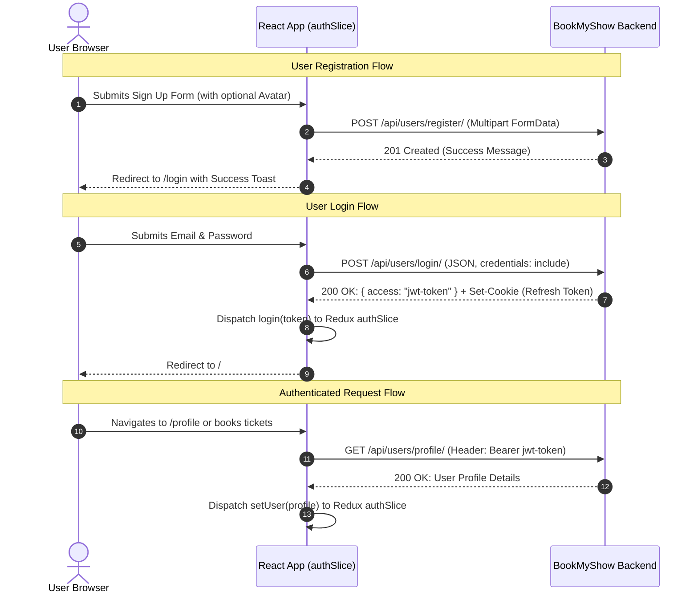

# Authentication & User Sessions

This document describes the authentication lifecycle, session persistence, token management, and user authorization flows implemented in the **BookMyShow Frontend**.

---

## 1. Authentication Architecture

The application implements a secure **JSON Web Token (JWT)** authentication model:



---

## 2. Redux Authentication State (`authSlice`)

The central authentication slice is defined in [`src/features/authSlice.ts`](../src/features/authSlice.ts):

```typescript
type AuthType = {
    isAuthenticated: boolean;
    token: string;
    user: {
        id: number;
        name: string;
        email: string;
        profile_pic?: string | null;
        phone_number?: string | null;
    } | null;
};
```

### Action Reducers

- **`login(token)`**: Stores the active access token and sets `isAuthenticated = true`.
- **`setUser(user)`**: Updates the cached profile metadata.
- **`logout()`**: Resets authentication state to `initialState` (`isAuthenticated = false`, `token = ''`, `user = null`).

---

## 3. Registration Flow (`/signup`)

The registration container in [`src/containers/SignUp/SignUp.container.tsx`](../src/containers/SignUp/SignUp.container.tsx) coordinates user onboarding:

1. **Client-Side Validation**:
   Inputs are validated against `signUpSchema`:
    - Valid email syntax.
    - Password requirements (minimum 8 characters, combination of upper/lower case and numbers).
    - Confirmation password exact match.
    - Optional profile image validation (file size under 2MB, valid image MIME types via `imageSchema`).
2. **Multipart Request**:
   The registration payload is serialized into `FormData` using `getFormData` to support image streaming.
3. **Execution**:
   Calls `useRegisterUserMutation`. Upon success, a toast alert notifies the user, and the browser redirects to `/login`.

---

## 4. Login Flow (`/login`)

The login container in [`src/containers/Login/Login.container.tsx`](../src/containers/Login/Login.container.tsx) handles sign-in:

1. **Submission**:
   Validates credentials via `loginSchema` and dispatches `useLoginUserMutation`.
2. **Token Storage**:
   Upon receiving `{ access: string }`, the container dispatches:
    ```typescript
    dispatch(login(access));
    ```
3. **Redirection**:
   Navigates the user to `/` (or their previously requested page).

---

## 5. Token Refresh & Cookie Security

- **Refresh Token Storage**: The refresh token is transmitted and stored by the backend via an HTTP-only secure cookie, mitigating exposure to Cross-Site Scripting (XSS).
- **Refresh Endpoint**: When the access token expires, `useRefreshTokenMutation` calls `API_ROUTES.USERS.REFRESH_TOKEN` with `credentials: 'include'`. The backend validates the cookie and returns a fresh access token.

---

## 6. Profile Management (`/profile`)

The user dashboard displays account info and allows real-time updates:

- **Data Query**: Profile details are queried with `useUserDetailsQuery(token)`.
- **Cache Tags**: `providesTags: ['userDetails']` guarantees that profile modifications triggered by `useUpdateUserDetailsMutation` automatically re-fetch fresh account data across the app.

---

## 7. Logout Flow

When a user initiates logout:

1. Calls the `useLogoutMutation` endpoint (`POST /users/logout/`) to invalidate the backend session cookie.
2. Dispatches `logout()` to the Redux store to clear client tokens and user details.
3. React UI immediately re-renders, switching the Header to show the Guest state (Sign In / Register buttons).
