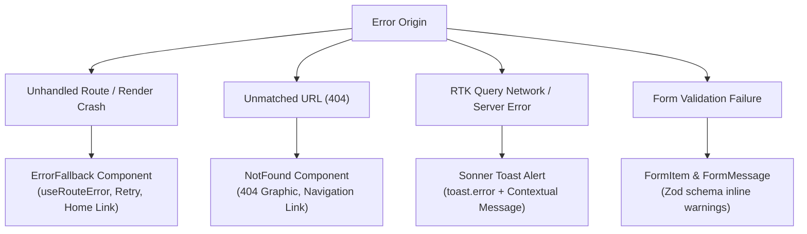

# Error Handling Strategy

This document describes the multi-tiered error handling architecture implemented in the **BookMyShow Frontend**, covering route boundaries, network failure fallbacks, form validation, and user notifications.

---

## 1. Multi-Tier Error Architecture



---

## 2. Route-Level Error Boundaries (`<ErrorFallback />`)

React Router 7's data router isolates rendering crashes using the `errorElement` property declared in [`src/router/routes.tsx`](../src/router/routes.tsx).

When a runtime JavaScript error or failed loader occurs in any route:

1. React Router unmounts the broken view and renders `<ErrorFallback />`.
2. The error object is inspected using `useRouteError()`.

```tsx
// src/containers/ErrorFallback/ErrorFallback.container.tsx
export const ErrorFallback = () => {
    const error = useRouteError();
    const message = isRouteErrorResponse(error)
        ? error.statusText
        : error instanceof Error
          ? error.message
          : 'Something unexpected happened while loading this page.';

    return (
        <section className="flex min-h-96 flex-col items-center justify-center gap-4 py-8 text-center">
            
            <TypographyP className="font-semibold text-destructive">
                Something went wrong
            </TypographyP>
            <TypographyH1>We could not load this page</TypographyH1>
            <TypographyP className="max-w-md text-muted-foreground">
                {message || 'Please try again, or return to the home page.'}
            </TypographyP>
            <div className="mt-2 flex gap-3">
                <Button
                    variant="outline"
                    onClick={() => window.location.reload()}
                >
                    Try again
                </Button>
                <Button asChild>
                    <Link to={ROUTES.HOME}>Back to home</Link>
                </Button>
            </div>
        </section>
    );
};
```

---

## 3. 404 Route Catch-All (`<NotFound />`)

When a visitor attempts to access a path not mapped in [`ROUTES`](../src/constants/routes.constants.ts):

- Caught by wildcard route: `{ path: ROUTES.NOT_FOUND, element: <NotFound /> }`.
- Renders the `NotFound` container featuring vector graphic `not-found.svg` and a call-to-action redirecting to the homepage.

---

## 4. API & Network Failure Handling

All backend queries and mutations are managed through RTK Query, which captures HTTP and network status codes:

### Mutation Error Handling Pattern

Mutations use `.unwrap()` wrapped in a `try...catch` block to handle exceptions and provide feedback:

```typescript
try {
    const response = await loginUser(values).unwrap();
    dispatch(login(response.access));
    navigate('/');
} catch (error) {
    toast.error(
        'Failed to Login. Please check your credentials and try again.',
    );
}
```

### Auto-Refetch on Network Reconnection

With `setupListeners(store.dispatch)` enabled in [`src/store/index.ts`](../src/store/index.ts), if the user's internet connection drops and recovers, RTK Query automatically re-fetches stale or failed queries.

---

## 5. Form Validation Feedback

Forms prevent invalid payloads from hitting the network using **React Hook Form** paired with **Zod**:

- **Real-Time Feedback**: Errors display directly beneath the invalid input using shadcn's `<FormMessage />`.
- **Form Submission Lock**: The submit button is disabled and shows an animated `<Loader2 className="animate-spin" />` while queries or mutations are in flight.
- **Accessibility**: Failed fields receive `aria-invalid="true"` and an `aria-describedby` reference linking to the error message.

---

## 6. Stacked Toast Alerts (Sonner)

The application provides transient feedback using the `Sonner` toast engine initialized in [`src/index.tsx`](../src/index.tsx):

- **Error Notifications**: `toast.error('Message')` for operational errors or failed submissions.
- **Success Notifications**: `toast.success('Message')` for completed actions (e.g., ticket cancelled, profile updated).
- **Theme Awareness**: Toaster adapts to dark and light mode automatically.
