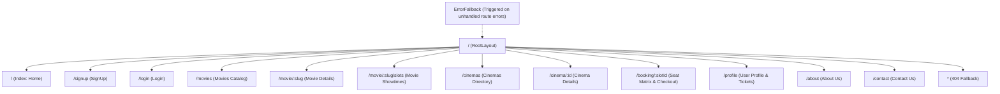

# Routing Architecture

This document describes the routing architecture, route hierarchy, navigation patterns, and error handling implemented with **React Router 7** in the **BookMyShow Frontend**.

---

## 1. Overview

The application utilizes React Router 7's data router configured via `createBrowserRouter` in [`src/router/routes.tsx`](../src/router/routes.tsx). This architecture provides:

- Centralized route declarations.
- Nested layout rendering with `<Outlet />`.
- Unified top-level error boundaries (`errorElement`).
- Catch-all 404 route handling.

---

## 2. Route Hierarchy & Table

All primary routes are nested under the root path (`/`) using `RootLayout` as the parent wrapper.



### Route Table

| Path                 | Constant             | Component / Page | Access           | Purpose                                                                   |
| :------------------- | :------------------- | :--------------- | :--------------- | :------------------------------------------------------------------------ |
| `/`                  | `ROUTES.HOME`        | `Home`           | Public           | Discovery landing page, hero carousel, latest & upcoming movies.          |
| `/movies`            | `ROUTES.MOVIES`      | `Movies`         | Public           | Full movie catalog with multi-select filters and infinite scroll.         |
| `/movie/:slug`       | `ROUTES.MOVIE`       | `Movie`          | Public           | Detailed movie synopsis, crew, trailer links, and quick booking triggers. |
| `/movie/:slug/slots` | `ROUTES.MOVIE_SLOTS` | `MovieSlots`     | Public           | Available showtimes for a movie grouped by cinema and date.               |
| `/cinemas`           | `ROUTES.CINEMAS`     | `Cinemas`        | Public           | Cinema directory with location and amenity filters.                       |
| `/cinema/:id`        | `ROUTES.CINEMA`      | `Cinema`         | Public           | Cinema profile with daily screening schedules and timings.                |
| `/booking/:slotId`   | `ROUTES.BOOKING`     | `Booking`        | Protected / Auth | Interactive seat map, live availability polling, and ticket reservation.  |
| `/login`             | `ROUTES.LOGIN`       | `Login`          | Public (Guest)   | User authentication form with JWT token issuance.                         |
| `/signup`            | `ROUTES.SIGNUP`      | `SignUp`         | Public (Guest)   | New account registration with profile image upload.                       |
| `/profile`           | `ROUTES.PROFILE`     | `Profile`        | Protected / Auth | User dashboard, active bookings, history, and ticket cancellation.        |
| `/about`             | `ROUTES.ABOUT_US`    | `Aboutus`        | Public           | Company mission, team, and platform information.                          |
| `/contact`           | `ROUTES.CONTACT_US`  | `Contactus`      | Public           | Inquiry submission and support form.                                      |
| `*`                  | `ROUTES.NOT_FOUND`   | `NotFound`       | Public           | Catch-all 404 page for unmatched URLs.                                    |

---

## 3. Centralized Route Constants

All route strings are centralized in [`src/constants/routes.constants.ts`](../src/constants/routes.constants.ts) to prevent brittle hardcoded paths:

```typescript
export const ROUTES = {
    HOME: '/',
    SIGNUP: '/signup',
    LOGIN: '/login',
    MOVIES: '/movies',
    MOVIE: '/movie/:slug',
    MOVIE_SLOTS: '/movie/:slug/slots',
    CINEMAS: '/cinemas',
    CINEMA: '/cinema/:id',
    BOOKING: '/booking/:slotId',
    PROFILE: '/profile',
    ABOUT_US: '/about',
    CONTACT_US: '/contact',
    NOT_FOUND: '*',
} as const;
```

---

## 4. Layout Wrapping & Nesting

The application structure uses `RootLayout`:

```tsx
// src/layouts/RootLayout/RootLayout.layout.tsx
export const RootLayout = () => (
    <div className="min-h-screen flex flex-col min-w-100 max-w-384 mx-auto">
        <Header />
        <main className="flex-1 px-4 md:px-10">
            <Outlet />
        </main>
        <Footer />
    </div>
);
```

Benefits:

- Navigation header and footer remain mounted between page changes, preserving state and scroll positions where appropriate.
- Responsive container constraints (`min-w-100 max-w-384 mx-auto`) are uniformly applied across all views.

---

## 5. Navigation Patterns

### Declarative Navigation with `<Link>`

Use `<Link>` or `<Button asChild><Link to={...}>` for accessible internal navigation:

```tsx
import { Link } from 'react-router';
import { ROUTES } from '@/constants';

<Link to={ROUTES.MOVIES} className="hover:underline">
    Explore All Movies
</Link>;
```

### Programmatic Navigation with `useNavigate`

Use `useNavigate` for redirecting after successful mutations or user actions:

```tsx
import { useNavigate } from 'react-router';
import { ROUTES } from '@/constants';

const navigate = useNavigate();

const handleLoginSuccess = async () => {
    await navigate(ROUTES.HOME);
};
```

### Extracting Dynamic Parameters

Dynamic segments (`:slug`, `:id`, `:slotId`) are retrieved using `useParams`:

```tsx
import { useParams } from 'react-router';

const { slug } = useParams<{ slug: string }>();
```

---

## 6. Route Error Boundaries

The root route is configured with an `errorElement`:

```tsx
// src/router/routes.tsx
export const router = createBrowserRouter([
    {
        path: ROUTES.HOME,
        element: <RootLayout />,
        errorElement: <ErrorFallback />,
        children: [
            /* ... */
        ],
    },
]);
```

When an unhandled runtime error or failed route transition occurs:

1. React Router catches the error and mounts `<ErrorFallback />`.
2. `<ErrorFallback />` reads the error details with `useRouteError()`.
3. If the error is an HTTP route error response (`isRouteErrorResponse(error)`), it displays the status text; otherwise, it formats the error message.
4. Users are presented with a **Try again** button (refreshing the page) and a **Back to home** button.
