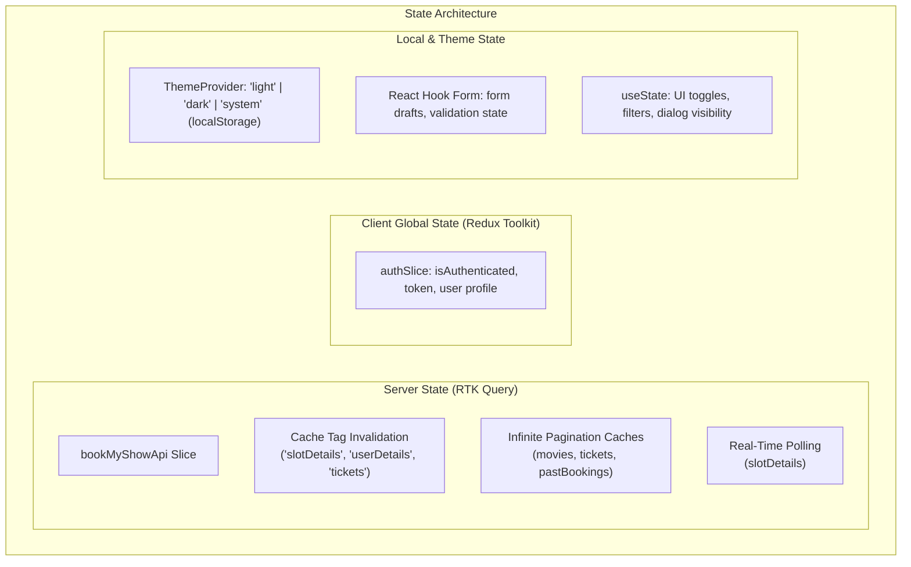

# State Management

This document details the state management architecture of the **BookMyShow Frontend**, explaining the division between client UI state and server cache state, Redux store configuration, RTK Query caching policies, and typed custom hooks.

---

## 1. Architectural Strategy

The application separates state into three distinct classifications:



---

## 2. Redux Store Configuration

The global Redux store is configured in [`src/store/index.ts`](../src/store/index.ts):

```typescript
import { configureStore } from '@reduxjs/toolkit';
import { setupListeners } from '@reduxjs/toolkit/query';
import { useDispatch, useSelector } from 'react-redux';
import { authSlice } from '@/features/authSlice';
import { api } from '@/services';

export const store = configureStore({
    reducer: {
        authReducer: authSlice.reducer,
        [api.reducerPath]: api.reducer,
    },
    middleware: (getDefaultMiddleware) =>
        getDefaultMiddleware().concat(api.middleware),
});

export type RootState = ReturnType<typeof store.getState>;
export type AppDispatch = typeof store.dispatch;

// Enables refetchOnFocus and refetchOnReconnect behaviors
setupListeners(store.dispatch);

export const useAppSelector = useSelector.withTypes<RootState>();
export const useAppDispatch = useDispatch.withTypes<AppDispatch>();
```

### Strongly Typed Hooks

Developers must always use the pre-typed hooks `useAppSelector` and `useAppDispatch` instead of raw `useSelector` and `useDispatch`.

---

## 3. Client State: `authSlice`

Client authentication state is encapsulated in [`src/features/authSlice.ts`](../src/features/authSlice.ts):

### State Interface

```typescript
type AuthType = {
    isAuthenticated: boolean;
    token: string;
    user: {
        id: number;
        name: string;
        email: string;
        profile_pic?: string | null;
        phone_number?: string | null;
    } | null;
};
```

### Reducer Actions

- **`login(token: string)`**: Sets the active JWT access token and marks `isAuthenticated = true`.
- **`setUser(user: UserDetails)`**: Stores or updates the current user's profile metadata.
- **`logout()`**: Clears the authentication token, user object, and sets `isAuthenticated = false`.

### Usage Example

```tsx
import { useAppDispatch, useAppSelector } from '@/store';
import { login, logout } from '@/features';

const dispatch = useAppDispatch();
const { isAuthenticated, user } = useAppSelector((state) => state.authReducer);

// On login success:
dispatch(login(accessToken));

// On user logout:
dispatch(logout());
```

---

## 4. Server State & Caching: RTK Query

Server state is managed via RTK Query in [`src/services/services.ts`](../src/services/services.ts).

### Cache Tags & Automated Invalidation

Cache tags ensure that when data is modified on the server, all dependent queries automatically re-fetch the latest data:

| Tag Type      | Provided By              | Invalidated By                      |
| :------------ | :----------------------- | :---------------------------------- |
| `slotDetails` | `slotDetails` query      | `booking`, `cancelTicket` mutations |
| `userDetails` | `userDetails` query      | `updateUserDetails` mutation        |
| `tickets`     | `tickets` infinite query | `booking`, `cancelTicket` mutations |

### Example: Booking Mutation with Invalidation

```typescript
booking: builder.mutation<
    { message: string },
    { data: SeatBookingRequest; token: string }
>({
    query: ({ data, token }) => ({
        url: API_ROUTES.BOOKINGS.BOOKING,
        body: data,
        method: 'POST',
        credentials: 'include',
        headers: { authorization: `Bearer ${token}` },
    }),
    invalidatesTags: ['slotDetails', 'tickets'],
}),
```

When a user books seats, RTK Query automatically invalidates the `slotDetails` and `tickets` tags, triggering immediate re-fetching of the seat layout and user ticket list.

---

## 5. Infinite Pagination Queries

For data collections like movies and user tickets, RTK Query's `infiniteQuery` API handles page-by-page fetching and accumulated caching:

```typescript
movies: builder.infiniteQuery<
    PaginatedQueryResponse<Movie>,
    { languages?: string; genres?: string; cinema?: string; slot_date?: string },
    number
>({
    query: ({ pageParam, queryArg }) => ({
        url: API_ROUTES.MOVIES.LIST,
        params: {
            page: pageParam,
            ...queryArg,
        },
    }),
    infiniteQueryOptions: {
        initialPageParam: 1,
        getNextPageParam: (lastPage, __, lastPageParam) => {
            if (lastPage.next) {
                return lastPageParam + 1;
            }
        },
    },
}),
```

In containers, this enables seamless infinite scrolling:

```tsx
const { data, fetchNextPage, hasNextPage, isFetchingNextPage } =
    useMoviesInfiniteQuery({
        languages: selectedLanguages.join(','),
        genres: selectedGenres.join(','),
    });
```

---

## 6. Real-Time Seat Availability Polling

To prevent race conditions when multiple users attempt to reserve the same seats simultaneously, the `slotDetails` query supports configurable polling intervals:

```tsx
import { useSlotDetailsQuery } from '@/services';
import { SLOT_DETAILS_POLLING_INTERVAL_TIME } from '@/constants';

const { data: slot, isLoading } = useSlotDetailsQuery(
    { id: slotId },
    { pollingInterval: SLOT_DETAILS_POLLING_INTERVAL_TIME },
);
```

This guarantees the seat matrix updates in real-time while the user is actively viewing the screen.

---

## 7. Theme State Management

Theme state is managed through React Context in [`src/components/Theme/`](../src/components/Theme/):

- **Storage**: Key `vite-ui-theme` stored in `localStorage`.
- **Options**: `'dark'`, `'light'`, or `'system'`.
- **DOM Integration**: Injects or removes the `dark` class from the `document.documentElement` element, activating Tailwind CSS 4 dark styles.
- **Hook**: `useTheme()` returns `{ theme, setTheme }`.
